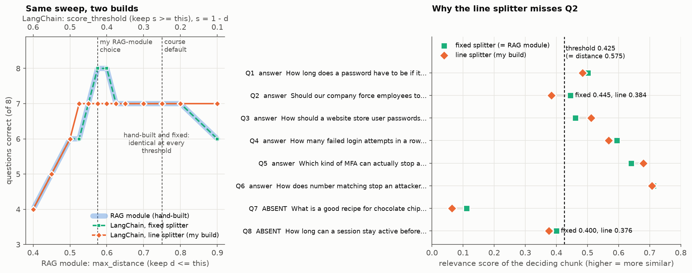

# My RAG, rebuilt with LangChain

The question-and-answer bot from `../rag_project/`, built a second time with LangChain on the same five NIST and
CISA documents about passwords and multifactor authentication, and tested on the same eight questions. A
`DirectoryLoader` and `CharacterTextSplitter` replace my chunking loop, `Chroma.from_documents` replaces my embed
and add calls, a score-threshold retriever replaces my `retrieve()` function, a `ChatPromptTemplate` replaces my
prompt assembly, and one LCEL chain built with `|` replaces my `ask()` function. A `RunnableBranch` in the chain
refuses without calling a model when nothing relevant is retrieved. At the RAG-module settings the LangChain
version finds 5 of 6 answers and refuses both unanswerable questions; the hand-built version found all 6. The
difference is where the splitter cuts the chunks: with fixed-width chunks like my hand-written ones, LangChain
reproduces all 33 RAG-module configurations exactly. Everything runs offline on a CPU with no API key.

Shamak Patel · IT7075 Applied AI for Cybersecurity · University of Cincinnati · Fall 2026

## What is here

| Path | What it is |
|---|---|
| `langchain_notebook.ipynb` | The notebook, saved with all outputs. Parts 1-7 are the course pipeline (five TODOs); Parts 8-12 are my rebuild, transcript, experiments, comparison and error analysis |
| `my_kb/` | My five documents, unchanged from `../rag_project/my_kb/` (the notebook checks every file's SHA-256) |
| `goldset.json` | My eight questions, unchanged from `../rag_project/goldset.json` |
| `results_langchain.csv` | 76 configurations: score threshold, k, chunk size, overlap, splitter and distance metric, each changed one at a time, plus all 33 RAG-module configurations re-run; the like-for-like rows are flagged |
| `figure_comparison.png` | The threshold sweep for both versions, and the score that decides each question |
| `course_kb/`, `framework_goldset.json`, `results_course_kb.csv` | The course knowledge base and questions used in Parts 1-7, and their results |

## Results

| Configuration (chunk / overlap / k / threshold) | Found | Refused |
|---|---|---|
| RAG module, my settings: 600 / 100 / 4 / distance ≤ 0.575 | 6/6 | 2/2 |
| LangChain, like for like: 600 / 100 / 4 / score ≥ 0.425 | 5/6 | 2/2 |
| LangChain with fixed-width chunks, same settings | 6/6 | 2/2 |

LangChain's threshold is a relevance score, where higher means more similar. In a cosine store the score is
exactly 1 − distance, so a maximum distance of 0.575 becomes a minimum score of 0.425.



## Run it

```bash
pip install -r requirements.txt
jupyter notebook langchain_notebook.ipynb
```

Run all cells from the top, from inside this folder, and restart the kernel before running again (re-running the
store cells in one kernel duplicates the chunks; Part 2 explains). The first run downloads the embedding model
(about 90 MB). With a working `OPENAI_API_KEY` in `.env`, the model stage of the chain uses `gpt-4o-mini`; without
one, an offline stand-in quotes the most relevant sentences from the retrieved chunks.
