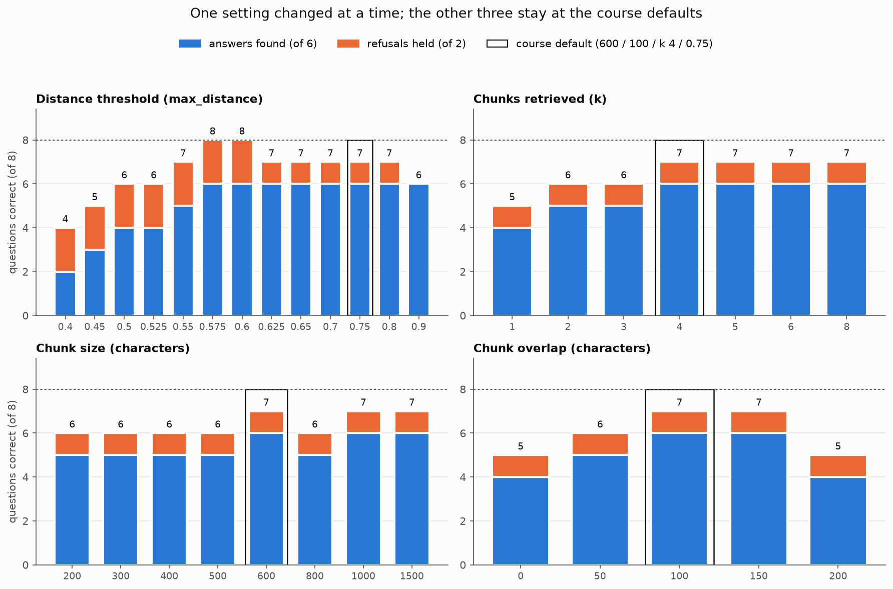

# RAG over NIST and CISA authentication guidance

A retrieval-augmented generation (RAG) system, built without frameworks, that answers questions about password
rules and multifactor authentication (MFA) from five excerpts of NIST SP 800-63B-4 and two CISA fact sheets. It
cuts the documents into overlapping chunks, embeds them with the small local model `all-MiniLM-L6-v2`, stores them
in ChromaDB, retrieves the chunks closest in meaning to a question, and answers only from those chunks, citing the
file each claim came from. When nothing close enough is found, it says "I don't know" instead. Eight test questions
(six the documents answer, two they do not) score each configuration. The experiments show that the distance
threshold decides whether the system refuses or makes things up: the course default of 0.75 answered a question
the documents never cover, and 0.575 scored 8/8. Everything runs offline on a CPU with no API key.

Shamak Patel · IT7075 Applied AI for Cybersecurity · University of Cincinnati · Fall 2026

## What is here

| Path | What it is |
|---|---|
| `rag_notebook.ipynb` | The notebook, saved with all outputs. Parts 1-5 are the course pipeline (five TODOs); Parts 6-9 are my RAG, experiments and error analysis |
| `my_kb/` | My five knowledge-base documents (about 12,000 characters) |
| `my_kb/SOURCES.md` | Where each document came from and exactly what was cut |
| `goldset.json` | My eight questions, with the evidence phrase that proves each answerable one |
| `results.csv` | 33 configurations: chunk size, overlap, k and threshold, each changed one at a time |
| `figure.png` | Questions correct for every configuration |
| `figure_distances.png` | Why the threshold matters: the distance of the deciding chunk for each question |
| `course_kb/`, `baseline_goldset.json` | Course-provided documents and questions used in Parts 1-5 (`ssrf.txt` is from the OWASP SSRF Prevention Cheat Sheet, CC BY-SA 4.0) |

## Results

| Configuration (chunk / overlap / k / threshold) | Answers found | Refusals held |
|---|---|---|
| Course defaults: 600 / 100 / 4 / 0.75 | 6/6 | 1/2 |
| My settings: 600 / 100 / 4 / 0.575 | 6/6 | 2/2 |



Eight questions are very few, and the threshold was chosen on the same questions it is scored on, so read 8/8 as
"this setting works for these questions", not as a measured accuracy. Part 9 of the notebook discusses this.

## Run it

```bash
pip install -r requirements.txt
jupyter notebook rag_notebook.ipynb
```

Run all cells from the top, from inside this folder. The first run downloads the embedding model (about 90 MB).
Setting `OPENAI_API_KEY` in the environment makes the generate step use an LLM (`gpt-4o-mini`); without it, the
notebook answers offline by quoting the most relevant sentences from the retrieved chunks.
